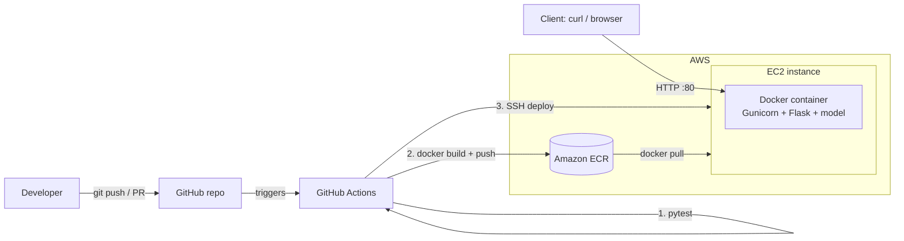

# Iris ML API — containerized model serving on AWS

A small machine-learning service that is **trained, containerized with Docker, pushed to Amazon ECR and deployed on an EC2 instance automatically by GitHub Actions**. A client sends flower measurements over HTTP and gets back the predicted Iris species.


> Project type: **ML model deployment** (assessment option 4), including the **containerized microservice on AWS** flow (option 1).

## What I built

| Piece | Technology |
|---|---|
| Model | scikit-learn `RandomForestClassifier` trained on the Iris dataset (~90% accuracy on a held-out test split) |
| API | Flask, served by Gunicorn (2 workers) |
| Container | Docker (`python:3.11-slim`, non-root user, health check, model baked in at build time) |
| Registry | Amazon ECR |
| Hosting | Amazon EC2 (Amazon Linux 2023), container published on port 80 |
| CI/CD | GitHub Actions: test → build → push → deploy → smoke test |

## Architecture



**Request flow (client → EC2 → container):** the client sends `POST /predict` to the EC2 public IP on port 80; Docker forwards it to port 8000 in the container; Gunicorn hands it to Flask; Flask validates the JSON, calls `model.predict_proba`, and returns JSON.

**Deploy flow:** a push to `main` runs the tests; only if they pass does the pipeline build the image, push it to ECR (tagged with the commit SHA and `latest`), SSH into EC2, pull that exact image, replace the running container, and finally call `/health` on the live server.

## API

| Method | Path | Description |
|---|---|---|
| GET | `/health` | Liveness check |
| GET | `/info` | Hostname of the serving container + app version (commit SHA) |
| POST | `/predict` | Body: `{"features": [sepal_length, sepal_width, petal_length, petal_width]}` |

```bash
curl -X POST http://<EC2_PUBLIC_IP>/predict \
  -H "Content-Type: application/json" \
  -d '{"features": [5.1, 3.5, 1.4, 0.2]}'
# {"confidence":1.0,"prediction":"setosa","probabilities":{"setosa":1.0,"versicolor":0.0,"virginica":0.0}}
```

Invalid input (missing key, wrong length, non-numbers, negatives) returns HTTP 400 with an error message.

## How to run

### Locally (Python)
```bash
python -m venv .venv && source .venv/bin/activate
pip install -r requirements-dev.txt
python -m app.train            # trains and saves model/iris_model.joblib
gunicorn -b 0.0.0.0:8000 app.main:app
./scripts/demo.sh http://localhost:8000
```

### Locally (Docker)
```bash
docker build -t iris-ml-api .
docker run --rm -p 8000:8000 iris-ml-api
```

### Deploy to AWS
Follow [`docs/AWS_SETUP.md`](docs/AWS_SETUP.md) (ECR repo, EC2 instance, IAM role, GitHub secrets). After that, every push to `main` deploys automatically.

## Tests

8 test cases in `tests/test_api.py` (health, two correct predictions, three input-validation failures, model accuracy threshold, info endpoint).

```bash
pytest -v
```

## CI/CD and blocking bad code

* `.github/workflows/ci-cd.yml` has two jobs: **`test`** (runs on every push and pull request) and **`deploy`** (`needs: test`, runs only on `main`). If a test fails, the deploy job never starts.
* **Branch protection** on `main` makes the `test` check *required* and requires pull requests, so failing code cannot be merged or pushed. Setup steps are in `docs/AWS_SETUP.md` (section 6).
* Optional local guard: `cp scripts/pre-push .git/hooks/pre-push` blocks `git push` when tests fail on your machine.

## Repository layout

```
app/            Flask API (main.py) and training script (train.py)
tests/          Unit tests
Dockerfile      Container image
scripts/        EC2 bootstrap, demo requests, pre-push hook
docs/           AWS setup guide, presentation script
.github/workflows/ci-cd.yml   Pipeline
```

## Possible extensions
Put two EC2 instances behind an Application Load Balancer (horizontal scaling; `/info` shows which container served each request), add HTTPS, or move to ECS/Fargate.
